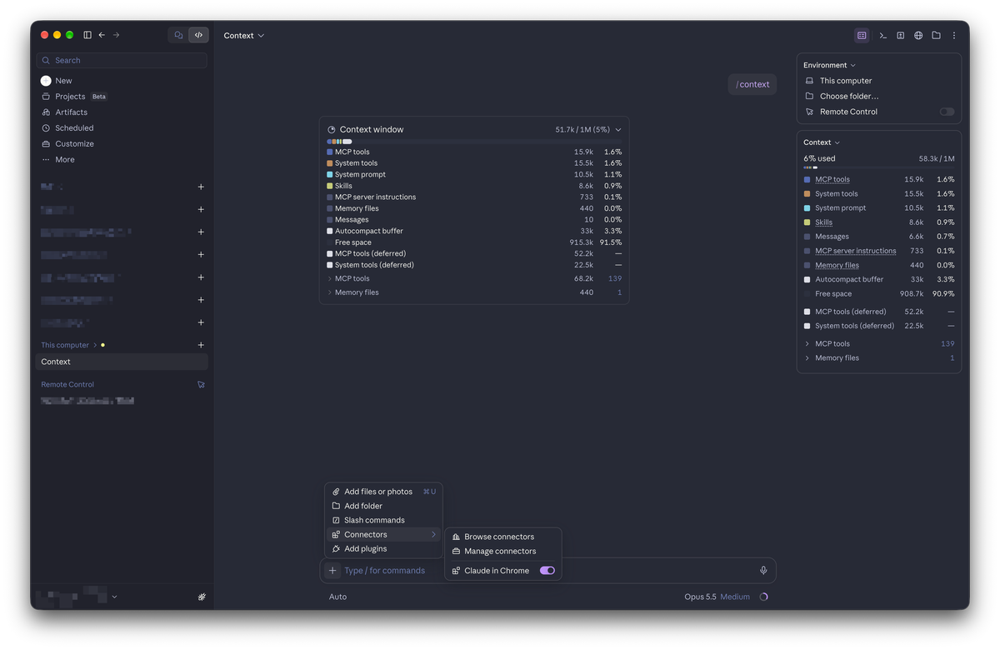
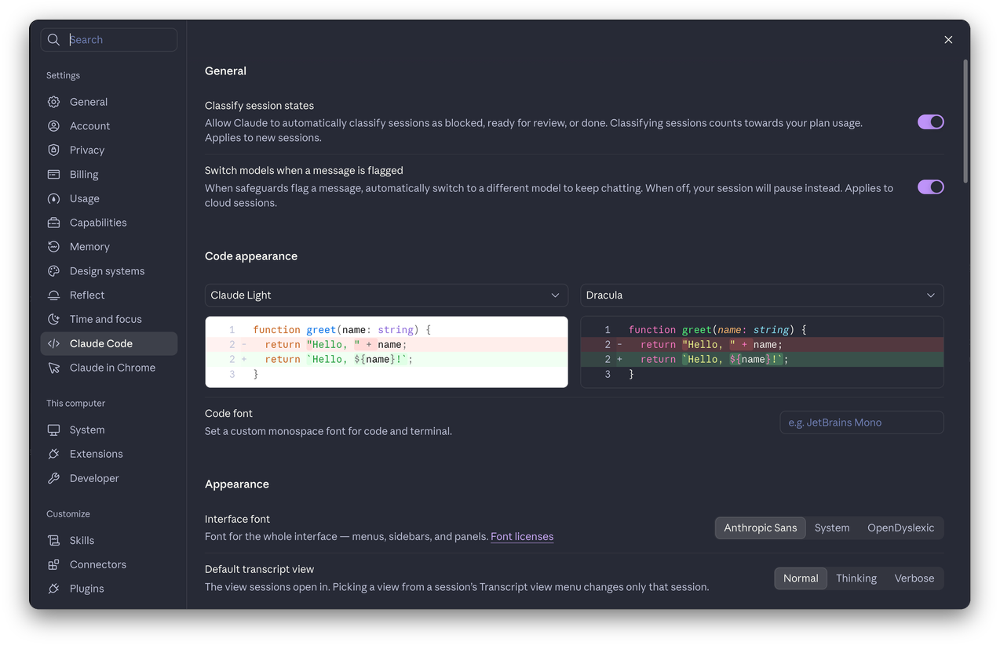
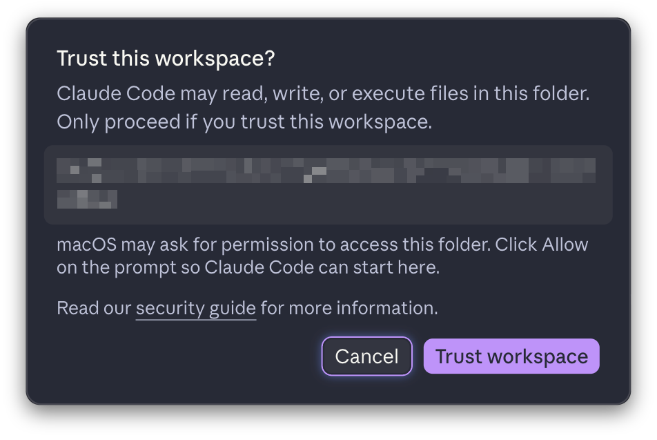

# Claude Desktop Themes

Color themes and code font size for the Claude Desktop app, applied from DevTools.

| Theme |
|---|
| [Ayu Dark](themes/ayu-dark/apply-theme.js) |
| [Catppuccin Mocha](themes/catppuccin-mocha/apply-theme.js) |
| [Dracula](themes/dracula/apply-theme.js) |
| [Monokai](themes/monokai/apply-theme.js) |
| [One Dark Pro](themes/one-dark-pro/apply-theme.js) |
| [Slack Dark](themes/slack-dark/apply-theme.js) (Slack-inspired, unofficial) |
| [Solarized Dark](themes/solarized-dark/apply-theme.js) |
| [Solarized Light](themes/solarized-light/apply-theme.js) |
| [Tokyo Night](themes/tokyo-night/apply-theme.js) |

## Screenshots

<p align="center">
  <a href="docs/screenshots/preview_1.png"></a>
  <a href="docs/screenshots/preview_2.png"></a>
</p>

<p align="center">
  
</p>

## Setup
Do this once. The example uses Dracula; for another theme, swap `dracula` for its folder name under `themes/` (e.g. `tokyo-night`).

1. **Enable developer mode:** in Claude Desktop, choose **Help → Troubleshooting → Enable Developer Mode**.
2. **Open DevTools:** choose **Developer → Show Dev Tools**.
3. **Create the snippet:**
   - In DevTools, open the **Sources** tab, then the **Snippets** sub-tab. It may be hidden behind `»` in the left pane.
   - Click **+ New snippet** and name it `dracula`.
   - Paste the full contents of [`themes/dracula/apply-theme.js`](themes/dracula/apply-theme.js) and save with **Ctrl+S** (macOS: **Cmd+S**).
4. **Apply it:** press **Ctrl+Enter** (macOS: **Cmd+Enter**). The app switches to Dracula.

DevTools keeps the snippet between sessions. Repeat step 3 for each theme you want available.

## Reapply after each launch
Snippets don't run automatically (the app has no startup hook), so after each launch:

1. Press **Ctrl+Alt+I** (macOS: **Cmd+Option+I**) to open DevTools.
2. Press **Ctrl+P** (macOS: **Cmd+P**), type `!dracula`, and press Enter.

Running another theme's snippet replaces the current theme. A theme lasts until the window reloads; run the snippet again after that. To undo it, run:

```js
document.getElementById('custom-theme').remove()
```

## Make a theme
Requires [uv](https://docs.astral.sh/uv/) ([Node.js](https://nodejs.org/) is optional, only for the `node --check` step in `AGENTS.md`) and the base CSS files in `css-dump/`: `all.css`, `vars.css` and `vars.colors.css`. They're copied from the app's own stylesheets, so they aren't included in this repo; create them yourself first. The steps are in [AGENTS.md → How to create the CSS dumps](AGENTS.md#how-to-create-the-css-dumps). Using the included themes doesn't need them.

### With an agent
Open this folder in a coding agent such as Claude Code, which reads `AGENTS.md` for the project rules, and ask:

> Create a **Nord** dark theme in `themes/nord/`. Copy an existing `palette.toml`, use the official Nord colors, and build it with `generator/generate.py`. Then run the checks in `AGENTS.md` and give me the contrast of primary and muted text against the background.

Replace "Nord" with any theme or palette you like. When it's done, create a snippet from the new `apply-theme.js` ([Setup](#setup), step 3).

### Manually
Copy a palette (e.g. `themes/dracula/palette.toml`) into a new folder, edit its colors, then build it:

```bash
uv run generator/generate.py themes/<name>/palette.toml
```

This writes `theme.css` and `apply-theme.js` next to the palette. See [generator/PALETTE.md](generator/PALETTE.md) for every palette key, including `code_font_size`.

After you regenerate a theme, paste the new `apply-theme.js` over its snippet.

## If a theme looks broken
Claude Desktop updates can rename or replace the CSS variables the themes override, so after an update a theme may stop applying fully, or some colors may look wrong. If that happens, refresh the variable list and rebuild your themes. The steps are in [AGENTS.md → How to create the CSS dumps](AGENTS.md#how-to-create-the-css-dumps).
